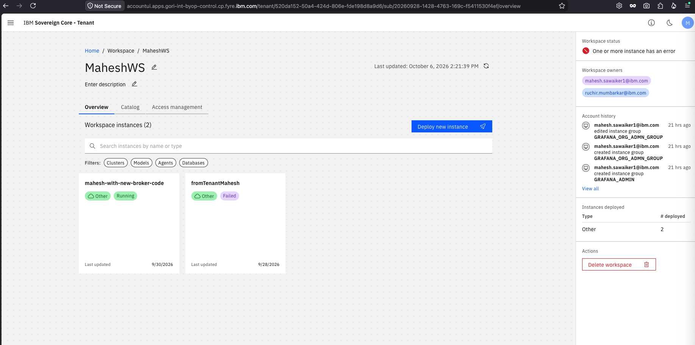
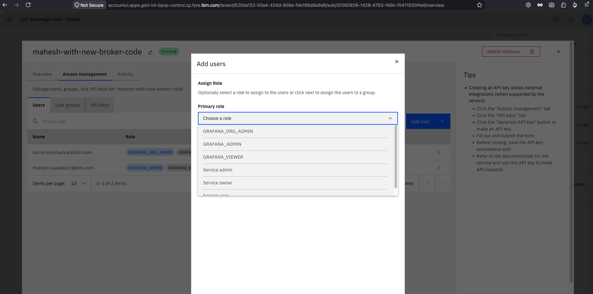
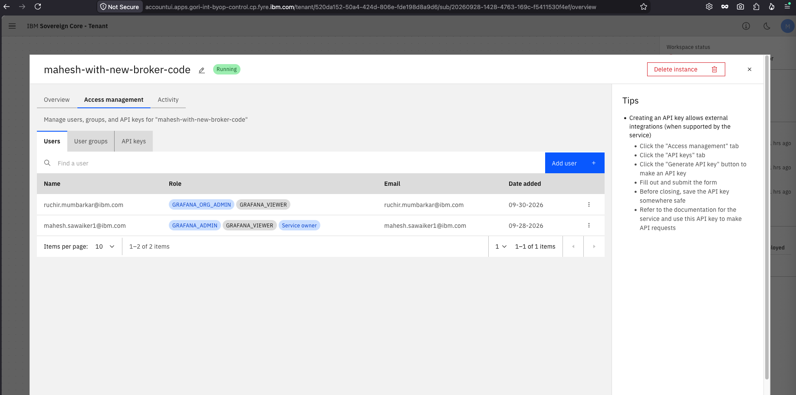
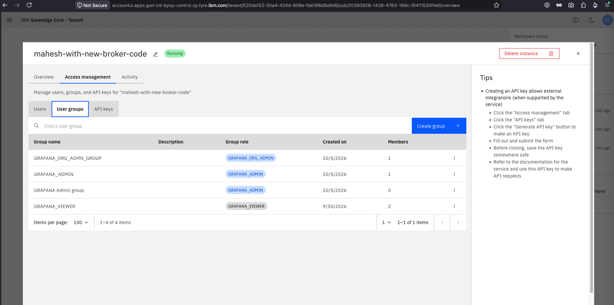

# IAM Integration Golden Pattern for BYOP Catalog Services
## Case Study: Grafana with OIDC and RBAC

> **Audience:** Developers packaging catalog services for Sovereign Core BYOP using OCI Helm charts.  
> **Goal:** Provide a practical, step-by-step guide on how to evaluate a software's access-control requirements and map them to Sovereign Core IAM capabilities — using the Grafana integration as a worked example.

---

> **Working example:** A ready-to-deploy catalog service package showing Grafana configured with OIDC which can be imported into the sovereign core catalog is available in [`components/software/open-source/grafana`](../../../components/software/open-source/grafana). Refer to it alongside this guide for concrete implementation details.

---

## Table of Contents

1. [Overview](#1-overview)
2. [Platform IAM Capabilities](#2-platform-iam-capabilities)
3. [What We Are Building](#3-what-we-are-building)
4. [Architecture and System Interactions](#4-architecture-and-system-interactions)
5. [Step 1 — Evaluate the Service's Authentication and Authorization Requirements](#5-step-1--evaluate-the-services-authentication-and-authorization-requirements)
6. [Step 2 — Design Roles and Access Control](#6-step-2--design-roles-and-access-control)
7. [Step 3 — Define the Role Mapping](#7-step-3--define-the-role-mapping)
8. [Step 4 — Deploy the IAM Proxy Sidecar](#8-step-4--deploy-the-iam-proxy-sidecar)
9. [Step 5 — Configure the Helm Chart for Provisioning](#9-step-5--configure-the-helm-chart-for-provisioning)
10. [Final Configuration Reference](#10-final-configuration-reference)
11. [Checklist Summary](#11-checklist-summary)
12. [References](#12-references)

---

## 1. Overview

Sovereign Core BYOP (Bring Your Own Product) allows ISVs and internal teams to deploy catalog services on OpenShift clusters managed by the platform. Each catalog service is packaged as a Helm chart and registered through the broker. The platform provides a shared **Account IAM** service that issues OIDC tokens, manages accounts, and enforces RBAC — removing the need for each catalog service to implement its own identity stack.

This document walks through the complete process of integrating a catalog service with IAM, using **Grafana** as a representative case. Grafana was selected because it has both **coarse-grained** (org-level) and **fine-grained** (dashboard-level) access control concepts, supports Generic OAuth (OIDC), and can optionally call an external endpoint to resolve roles — making it a realistic proxy for a broad class of ISV software.

---

## 2. Platform IAM Capabilities

Before integrating a catalog service, it helps to understand the key capabilities that Account IAM and IVIA expose to BYOP services. These are the building blocks every integration draws from.

For more information see the following IBM Knowledge center topics.
- [Sovereign Core Identity and Access Management](https://www.ibm.com/docs/en/sovereign-core/1.2.0?topic=started-identity-access-management) 
- [Roles and users](https://www.ibm.com/docs/en/sovereign-core/1.2.0?topic=overview-roles-users)

### 2.1 OIDC Client Registration

Every catalog service that uses browser-based authentication must be registered as an **OIDC client** in IBM Verify / IVIA via Account IAM's Dynamic Client Registration (DCR) API. 

- A **`client_id`** and **`client_secret`** used by the service to identify itself to IVIA.
- A registered **`redirect_uri`** — the callback URL (e.g. `https://grafana.<tenant>/login/generic_oauth`) that IVIA will send the authorization code to after user login.
- The allowed **OAuth scopes** (`openid`, `email`, `profile`) and grant types (`authorization_code` with PKCE, `refresh_token`).

Once registered, the service can participate in the standard OIDC `authorization_code` flow: the browser is redirected to IVIA for login, IVIA issues an authorization code, the service exchanges the code for an access token at `POST /iviaop/oauth2/token`.

#### 2.1.1 Obtaining the Token for Client Registration

An API key is available to the MSP that can be used to generate tokens with account-level write permissions. To generate the bearer token required for client registration, call `POST /api/2.0/apikeys/token` (or scoped endpoint `POST /api/2.0/accounts/{accountId}/apikeys/token`):

```bash
curl -X 'POST' \
  'https://<IAM_URL>/api/2.0/apikeys/token' \
  -H 'accept: application/json' \
  -H 'Content-Type: application/json' \
  -d '{
    "apikey": "<MSP_API_KEY>"
  }'
```

The resulting token contains the necessary claims to register clients:

```json
{
  "accountId": "global_account",
  "roles": {
    "ACCOUNT": [
      "mcsp-write"
    ]
  }
}
```

#### 2.1.2 Registering the OIDC Client

Using the bearer token obtained above, register the OIDC client via `POST /api/2.0/{isvTenantType}/clients` (where `{isvTenantType}` is `apps` or `msp`, typically `apps`):

**Endpoint:** `POST /api/2.0/{isvTenantType}/clients`

**Request Body Schema:**
```json
{
  "redirectUris": [
    "string"
  ],
  "clientName": "string",
  "grantTypes": [
    "string"
  ],
  "scopes": [
    "string"
  ],
  "singleLogoutSettings": {
    "logoutEndpoint": "string",
    "logoutOption": "string",
    "postLogoutRedirectUris": [
      "string"
    ],
    "requireSessionId": true
  },
  "clientId": "string",
  "clientSecret": "string"
}
```

**Example Request:**
```bash
curl -X 'POST' \
  'https://<IAM_URL>/api/2.0/apps/clients' \
  -H 'accept: application/json' \
  -H "Authorization: Bearer $TOKEN" \
  -H 'Content-Type: application/json' \
  -d '{
    "clientId": "grafana-app",
    "clientName": "Grafana app for testing RBAC",
    "clientSecret": "<CLIENT_SECRET>",
    "redirectUris": [
      "https://grafananew.<tenant-domain>/login/generic_oauth"
    ],
    "grantTypes": [
      "authorization_code",
      "refresh_token"
    ],
    "scopes": [
      "openid",
      "profile",
      "email"
    ]
  }'
```

### 2.2 RBAC — Custom Roles at Product Level

Account IAM provides a **product-scoped RBAC model** that allows each catalog service to define its own named roles independent of the platform's built-in roles.

- **Role definitions** are created at the **product level** using the catalog tile name (`productId`, e.g. `grafananew`) as the scope. Each role has a name, description, and a `bindableLevel` of `SERVICE` — meaning the role can be bound to individual service instances.
- Roles are defined once per product and reused across all instances of that service.
- The Broker creates role definitions at first provisioning time via `POST /api/2.0/products/{productId}/roles`.

```
Product: grafananew
  ├── Role: GRAFANA_ORG_ADMIN  (bindableLevel: SERVICE)
  ├── Role: GRAFANA_ADMIN      (bindableLevel: SERVICE)
  └── Role: GRAFANA_VIEWER     (bindableLevel: SERVICE)
```

### 2.3 Role Binding at Service Instance Level

This is equivalent to inviting a user to use the service instance with a certain role using the Sovereign Core tenant UI. See [§7.2 Creating Role Bindings](#72-creating-role-bindings) for screenshots and step-by-step instructions.

**Role bindings** connect a user or group to a named role, scoped to a specific service instance (`serviceId`). This means that the same user can hold different roles on different Grafana instances — for example, `GRAFANA_ORG_ADMIN` on a dev instance and `GRAFANA_VIEWER` on a production instance.

- Bindings are created via `POST /api/2.0/services/{serviceId}/roles/{roleId}/bindings`.
- They can be managed by the **tenant administrator** directly through the Sovereign Core UI without requiring API access.
- Bindings can target individual users (by IAM subject ID) or groups.

### 2.4 Token Exchange — Enriched JWT with Role Claims

The base OIDC access token issued by IVIA does not contain service-scoped role information. Account IAM provides a **token enrichment endpoint** that accepts the base JWT and returns an enriched JWT with role claims added:

```
POST /api/2.0/services/{serviceId}/token
Body: { "jwt": "<base-access-token-from-ivia>" }

Response: enriched JWT containing:
{
  "roles": {
    "SERVICE": ["GRAFANA_ORG_ADMIN"],
    "ACCOUNT":  ["ACCOUNT_ADMIN"]
  }
}
```

- The `SERVICE` key holds roles bound to the specific service instance the user is accessing.
- The `ACCOUNT` key holds platform-level roles.
- This call is made **server-side** by the `iam-proxy` sidecar on behalf of the catalog service — the browser never directly calls this endpoint.

### 2.5 Capability Summary

| Capability                   | Provided by                                      | API / Mechanism                                                                     |
| ------------------------------| --------------------------------------------------| -------------------------------------------------------------------------------------|
| Token generation (API Key)   | Account IAM                                      | `POST /api/2.0/apikeys/token` (or `/api/2.0/accounts/global_account/apikeys/token`) |
| OIDC client registration     | Account IAM / IVIA                               | `POST /api/2.0/{isvTenantType}/clients`                                             |
| User authentication          | IBM Verify / IVIA                                | `GET /iviaop/oauth2/authorize`, `POST /iviaop/oauth2/token`                         |
| Custom role definitions      | Account IAM                                      | `POST /api/2.0/products/{productId}/roles`                                          |
| Role bindings (per instance) | Account IAM                                      | `POST /api/2.0/services/{serviceId}/roles/{roleId}/bindings`                        |
| Token enrichment with roles  | Account IAM                                      | `POST /api/2.0/services/{serviceId}/token`                                          |
| Userinfo (OIDC-compatible)   | `iam-proxy` sidecar                              | `GET http://localhost:9090/userinfo`                                                |
| Fine-grained authorisation   | Account IAM (optional), not used in this example | `POST /api/2.0/pdp`                                                                 |

---

## 3. What We Are Building

The goal is to integrate a Grafana instance deployed as a BYOP catalog service with the platform's IAM system so that:

- Users authenticate via **IBM Verify / IVIA** (the platform OIDC identity provider).
- Grafana resolves each user's **service-scoped role** (`GRAFANA_ORG_ADMIN`, `GRAFANA_ADMIN`, `GRAFANA_VIEWER`) from the IAM token enrichment API.
- Role assignment is managed by tenant administrators through the **Sovereign Core UI** — no custom user management inside Grafana.

For more details on OIDC support in Grafana see [Grafana Generic OAuth documentation](https://grafana.com/docs/grafana/latest/setup-grafana/configure-access/configure-authentication/generic-oauth/)

### Components involved

| Component | Role |
|---|---|
| **Account IAM** (`account-iam`) | Central service. Manages accounts, service definitions, roles, role bindings, and OIDC token issuance. Exposes REST APIs at `/api/2.0/`. |
| **IBM Verify / IVIA** | Identity Provider (IdP). Issues OIDC tokens after the user authenticates. Sovereign Core integrates IVIA as the upstream IdP behind Account IAM. |
| **IAM Proxy** (`iam-proxy`) | Sidecar container in the Grafana pod. Bridges Grafana's Generic OAuth `api_url` (OIDC userinfo endpoint) and the IAM token enrichment API (`/api/2.0/services/{id}/token`). Adds service-scoped `roles` to the userinfo response. |
| **Catalog Service (Grafana)** | The BYOP workload. Relies on IAM for authentication and role resolution via Generic OAuth. |
| **Broker** | Orchestrates service lifecycle — provisioning, deprovisioning, binding. Registers the service with Account IAM and creates the initial role definitions. |

### Key IAM identifiers

> Sovereign Core distinguishes two identifiers for a catalog service:
> - **`productId`** — the short name of the service configured while importing the service into the Sovereign Core catalog. (e.g. `grafananew`). Used when **creating role definitions**. Role Definitions are created as product level and **bindable** at the service instance level.
> - **`serviceInstanceId`** — the runtime instance identifier generated at provisioning time. Used for **token enrichment** and **role binding** calls.

---

## 4. Architecture and System Interactions

### 4.1 Architecture Diagram


### 4.2 OIDC Token and Role Enrichment Flow

Account IAM sits in front of IVIA and enriches tokens with account, subscription, and service-scoped role information. The full login sequence is:

```
Browser          Grafana           IVIA (IdP)        IAM Proxy       Account IAM
   │                 │                  │                 │                │
   │  GET /dashboard │                  │                 │                │
   │────────────────►│                  │                 │                │
   │                 │ redirect to      │                 │                │
   │◄────────────────│ /iviaop/oauth2/  │                 │                │
   │                 │ authorize        │                 │                │
   │  GET /authorize │                  │                 │                │
   │────────────────────────────────────►                 │                │
   │  login prompt   │                  │                 │                │
   │◄────────────────────────────────────                 │                │
   │  submit credentials               │                 │                │
   │────────────────────────────────────►                 │                │
   │  redirect with  │                  │                 │                │
   │  auth code      │                  │                 │                │
   │◄────────────────────────────────────                 │                │
   │  POST /callback │                  │                 │                │
   │────────────────►│                  │                 │                │
   │                 │ POST /token      │                 │                │
   │                 │(exchange code)   │                 │                │
   │                 │────────────────►│                  │                │
   │                 │ access_token     │                 │                │
   │                 │◄────────────────│                  │                │
   │                 │ GET /userinfo    │                 │                │
   │                 │ Bearer: <token> │                  │                │
   │                 │─────────────────────────────────►│                 │
   │                 │                  │                 │ POST /api/2.0/ │
   │                 │                  │                 │ services/{id}/ │
   │                 │                  │                 │ token          │
   │                 │                  │                 │───────────────►│
   │                 │                  │                 │ enriched JWT   │
   │                 │                  │                 │◄───────────────│
   │                 │ userinfo JSON    │                 │                │
   │                 │ {roles: {SERVICE:│                 │                │
   │                 │  [GRAFANA_ADMIN]}│                 │                │
   │                 │◄─────────────────────────────────│                 │
   │                 │ map role →       │                 │                │
   │                 │ 'Editor'         │                 │                │
   │  dashboard      │                  │                 │                │
   │◄────────────────│                  │                 │                │
```

The enriched JWT contains a `roles` claim structured as:

```json
{
  "roles": {
    "SERVICE": ["GRAFANA_ORG_ADMIN", "GRAFANA_VIEWER"],
    "ACCOUNT":  ["ACCOUNT_ADMIN"]
  }
}
```

The `SERVICE` key maps to roles bound at the service-instance level. The `ACCOUNT` key maps to platform-level roles.

### 4.3 Service Registration Flow (Broker / Admin)

At provisioning time, the Broker performs OIDC client registration and registers the service and its roles with Account IAM:

```
Broker / Admin         Account IAM / IVIA
       │                    │
       │  POST /api/2.0/apikeys/token  { apikey: "<MSP_API_KEY>" }
       │───────────────────►│
       │  { token: "<JWT with mcsp-write role>" }
       │◄───────────────────│
       │                    │
       │  POST /api/2.0/apps/clients  { clientId, clientSecret, redirectUris, ... }
       │───────────────────►│
       │  200 OK (OIDC Client Created)
       │◄───────────────────│
       │                    │
       │  POST /api/2.0/services  { name: "grafana" }
       │───────────────────►│
       │  { id: "<SERVICE_ID>" }
       │◄───────────────────│
       │                    │
       │  POST /api/2.0/products/grafananew/roles  { name: "GRAFANA_ORG_ADMIN" }
       │───────────────────►│
       │  { id: "<ROLE_ID_1>" }
       │◄───────────────────│
       │                    │
       │  (repeat for GRAFANA_ADMIN, GRAFANA_VIEWER)
       │                    │
       │───────────────────►│
       │  201 Created       │
       │◄───────────────────│
```

### 4.4 RBAC Model

Account IAM uses a three-tier RBAC model:

```
Product  (catalog tile name visible in the Sovereign Core UI, e.g. "grafananew")
  └── Role Definition  (e.g. GRAFANA_ORG_ADMIN)  — created via /api/2.0/products/{productId}/roles
        └── Role Binding  (user/group → role, scoped to a service instance)  — created via /api/2.0/services/{serviceId}/roles/{roleId}/bindings
```

| Concept          | API path                                                     | Description                                                                                              |
| -----------------| -------------------------------------------------------------| ---------------------------------------------------------------------------------------------------------|
| Role Definition  | `POST /api/2.0/products/{productId}/roles`                   | Declares a named role scoped to the product. `productId` is the catalog tile name from the UI. API only. |
| Role Binding     | `POST /api/2.0/services/{serviceId}/roles/{roleId}/bindings` | Assigns a user or group to a role for a specific service instance. Can be done via the UI.               |
| Token enrichment | `POST /api/2.0/services/{serviceId}/token`                   | Exchanges a base JWT for an enriched JWT containing role claims.                                         |
| Userinfo         | `GET http://localhost:9090/userinfo` (via `iam-proxy`)       | Bridges IAM enrichment API to the OIDC userinfo spec expected by Grafana.                                |

### 4.5 PDP (Policy Decision Point)

**Note**: This feature is not used in this example, but it is available to be used if the use case justifies it. This will be explored in future articles on the same topic.

For services requiring fine-grained, per-resource authorisation decisions, Account IAM exposes a PDP endpoint. The service sends a request containing:

- `subject`: the user identity (sub from the token)
- `action`: the action being performed (e.g. `read`, `write`)
- `resource`: the resource being accessed (e.g. a specific dashboard ID)

The PDP evaluates the relevant policies and returns an `allow` / `deny` decision. Grafana (open-source) does not support a PDP callback, so this is not used in the current integration. It is documented here for services that do.

---

## 5. Step 1 — Evaluate the Service's Authentication and Authorization Requirements

Before writing any code or configuration, audit the catalog service against the key dimensions below.

### 5.1 RBAC: Coarse-Grained vs. Fine-Grained Access Control

**Coarse-grained** access control governs what users can *do* at a high level — for example, "this user can log in and view dashboards" vs. "this user can create and edit dashboards." It maps cleanly to **roles**.

**Fine-grained** access control governs what users can do to *specific resources* — for example, "this user can view dashboard X but not dashboard Y." It typically requires a Policy Decision Point (PDP) that evaluates resource-level policies at runtime. Fine-grained models include **ReBAC** (Relationship-Based Access Control — access is derived from the relationship between the user and the resource, e.g. "owner of dashboard X") and **ABAC** (Attribute-Based Access Control — access is derived from attributes of the user, resource, or environment, e.g. "department = finance AND classification = internal").

| Dimension      | Grafana finding                                                                                                                       | Reference                                                                                                                                        |
| ----------------| ---------------------------------------------------------------------------------------------------------------------------------------| --------------------------------------------------------------------------------------------------------------------------------------------------|
| Coarse-grained | Grafana supports three built-in org roles: `Viewer`, `Editor`, `Admin`. These are coarse-grained.                                     | [Grafana Roles and Permissions](https://grafana.com/docs/grafana/latest/administration/roles-and-permissions/access-control/)                    |
| Fine-grained   | Grafana Enterprise adds dashboard-level RBAC. The open-source edition does not. For open-source, coarse-grained roles are sufficient. | [Grafana Folder & Dashboard Access Control](https://grafana.com/docs/grafana/latest/administration/roles-and-permissions/folder-access-control/) |
| Decision       | Map IAM service roles to Grafana's three org roles. No PDP call required for initial integration.                                     | —                                                                                                                                                |

**Questions to ask for your service:**
- Does the service distinguish users purely by role (coarse), or does it need per-resource rules (fine)?
- If fine-grained, does the service support an external authorisation endpoint (PDP callback)?

### 5.2 OIDC Support

Verify that the service supports **Generic OAuth 2.0 / OIDC** with the following capabilities, which are required by IAM:

| Requirement | Grafana support | Notes |
|---|---|---|
| `authorization_code` flow with PKCE | ✅ | Required for browser-based flows |
| Configurable `token_url` | ✅ | Points to IVIA token endpoint |
| Configurable `auth_url` | ✅ | Points to IVIA authorization endpoint |
| Configurable `userinfo` / `api_url` | ✅ | Will point to `iam-proxy` sidecar |
| Role extraction from token / userinfo | ✅ | Via JMESPath expression on `roles` claim |
| `openid email profile` scopes | ✅ | Standard OIDC scopes supported by IVIA |

If the service only supports **LDAP** or **SAML**, you will need to evaluate whether a protocol adapter sidecar is feasible — this is out of scope for the current pattern.

### 5.3 Support for External Endpoint to Fetch Roles / Permissions

Some services (like Grafana) call a separate `userinfo` endpoint after obtaining the access token in order to resolve the user's attributes and roles. Others decode the token locally.

| Pattern                   | Description                                                                                       | IAM mapping                               |
| ---------------------------| ---------------------------------------------------------------------------------------------------| -------------------------------------------|
| **Token-intrinsic roles** | Roles are embedded in the access/ID token as claims. No extra call needed.                        | IAM embeds `roles` in its enriched JWT    |
| **Userinfo endpoint**     | Service makes a POST/GET to a userinfo URL with the Bearer token.                                 | Requires `iam-proxy` sidecar (see Step 4) |
| **PDP callback**          | Service calls a policy endpoint per request, passing the user ID and the resource being accessed. | Use IAM `/api/2.0/pdp` endpoint if needed |

Grafana uses the **userinfo endpoint** pattern: after the OAuth flow it calls `GF_AUTH_GENERIC_OAUTH_API_URL` with the Bearer token. The raw IVIA token does not contain service-scoped roles — those are added by Account IAM via the `/api/2.0/services/{id}/token` enrichment call. Therefore a sidecar (`iam-proxy`) is needed to translate between the two.

---

## 6. Step 2 — Design Roles and Access Control

### 6.1 Grafana's Built-in Role Model

Grafana (OSS) supports one role per user per organisation:

| Grafana Role | Capabilities |
|---|---|
| `Viewer` | Read-only access to dashboards |
| `Editor` | Create and edit dashboards, but cannot manage users or data sources |
| `Admin` | Full org-level control — manage users, data sources, dashboards, alerting |

There is no need for fine-grained per-dashboard policies in the standard OSS deployment.

### 6.2 Do You Need Fine-Grained Policies?

Ask the following questions:

1. **Can all users with the same role see the same set of resources?** → Coarse-grained roles are sufficient.
2. **Do you need "user A can read resource R1 but not R2, while user B can read both"?** → Fine-grained policies (and PDP) are needed.
3. **Does the target service have an extensible authorisation hook (middleware, plugin, webhook)?** → Required for PDP integration.

For Grafana OSS, the answer to question 1 is **yes** — all Viewers see all dashboards. Coarse-grained roles are sufficient.

### 6.3 Role Design Decision

Three IAM roles are defined at the service level:

| IAM Role Name       | Maps to Grafana Role | Rationale                                                                |
| ---------------------| ----------------------| --------------------------------------------------------------------------|
| `GRAFANA_ORG_ADMIN` | `Admin`              | Platform administrators who manage org settings, users, and data sources |
| `GRAFANA_ADMIN`     | `Editor`             | Power users who create and manage dashboards                             |
| `GRAFANA_VIEWER`    | `Viewer`             | Read-only observers                                                      |

### 6.4 Action–Role Mapping (For Services Using PDP)

If your service calls the IAM PDP endpoint, you must define an explicit action-to-role mapping so the PDP knows which roles are allowed to perform which actions. This is not required for Grafana OSS, but is shown here as a reference.

| Service Action    | Required IAM Role   | Example                             |
| -------------------| ---------------------| -------------------------------------|
| `dashboard:read`  | `GRAFANA_VIEWER`    | A user reads a dashboard            |
| `dashboard:write` | `GRAFANA_ADMIN`     | A user creates or edits a dashboard |
| `org:admin`       | `GRAFANA_ORG_ADMIN` | A user manages org settings         |

Store this mapping in the Broker's configuration and pass it to the PDP evaluation request as the `action` field.

---

## 7. Step 3 — Define the Role Mapping

### 7.1 Registering the Roles with IAM

The Broker registers the catalog service on first provision. The registration produces a `productId` that is used in all subsequent IAM API calls.

```bash
# 1. Define roles at product level (productId = catalog tile name, e.g. "grafananew")

curl -X 'POST' \
  'https://account-iam.apps.gori-int-byop-control.cp.fyre.ibm.com/api/2.0/products/grafananew/roles' \
  -H 'accept: application/json' \
  -H "Authorization: Bearer $TOKEN" \
  -H 'Content-Type: application/json' \
  -d '{
  "name": "GRAFANA_ORG_ADMIN",
  "description": "Grafana org admin role at product level grafananew",
  "bindableLevel": "SERVICE"
}'

curl -X 'POST' \
  'https://account-iam.apps.gori-int-byop-control.cp.fyre.ibm.com/api/2.0/products/grafananew/roles' \
  -H 'accept: application/json' \
  -H "Authorization: Bearer $TOKEN" \
  -H 'Content-Type: application/json' \
  -d '{
  "name": "GRAFANA_ADMIN",
  "description": "Grafana admin role at product level grafananew",
  "bindableLevel": "SERVICE"
}'

curl -X 'POST' \
  'https://account-iam.apps.gori-int-byop-control.cp.fyre.ibm.com/api/2.0/products/grafananew/roles' \
  -H 'accept: application/json' \
  -H "Authorization: Bearer $TOKEN" \
  -H 'Content-Type: application/json' \
  -d '{
  "name": "GRAFANA_VIEWER",
  "description": "Grafana viewer role at product level grafananew",
  "bindableLevel": "SERVICE"
}'
```

### 7.2 Creating Role Bindings

Role bindings can be created by the tenant owner by logging into the tenant URL.








### 7.3 JMESPath Expression for Role Resolution

Grafana resolves its internal role from the userinfo JSON using the `GF_AUTH_GENERIC_OAUTH_ROLE_ATTRIBUTE_PATH` setting, which is a JMESPath expression. The userinfo response from `iam-proxy` contains:

```json
{
  "sub": "abc123",
  "email": "user@example.com",
  "name": "Jane Doe",
  "roles": {
    "SERVICE": ["GRAFANA_ORG_ADMIN"]
  }
}
```

The JMESPath expression evaluates left-to-right and stops at the first match:

```
contains(roles.SERVICE[], 'GRAFANA_ORG_ADMIN') && 'Admin' ||
contains(roles.SERVICE[], 'GRAFANA_ADMIN')     && 'Editor' ||
contains(roles.SERVICE[], 'GRAFANA_VIEWER')    && 'Viewer'
```

Priority order: `GRAFANA_ORG_ADMIN` → `GRAFANA_ADMIN` → `GRAFANA_VIEWER`. A user with multiple roles will receive the highest privilege.

---

## 8. Step 4 — Deploy the IAM Proxy Sidecar

### 8.1 Decision Framework

| Condition                                                             | Sidecar needed?                                                                                         |
| -----------------------------------------------------------------------| ---------------------------------------------------------------------------------------------------------|
| Service decodes the JWT locally and reads roles from the token claims | No — configure the service to read `roles.SERVICE[]` from the JWT                                       |
| Service calls a userinfo endpoint and expects OIDC UserInfo format    | Yes — deploy `iam-proxy` to bridge IAM's enrichment API to the OIDC userinfo spec                       |
| Service calls a custom PDP endpoint with its own request schema       | Yes — a custom adapter sidecar is needed to translate from the service's PDP format to IAM's PDP format |

For Grafana, the **userinfo endpoint** case applies. The `iam-proxy` sidecar is deployed in the same pod.

### 8.2 IAM Proxy Sidecar

The [`iam-proxy`](../../iam-proxy/) is a small Go HTTP service with one endpoint: `GET /userinfo`.

**Request flow:**

1. Grafana completes the OAuth code exchange and receives an access token from IVIA.
2. Grafana calls `GET http://localhost:9090/userinfo` with the Bearer access token.
3. `iam-proxy` forwards the token to Account IAM: `POST /api/2.0/services/{SERVICE_ID}/token`.
4. Account IAM returns an enriched JWT containing the `roles.SERVICE[]` claim.
5. `iam-proxy` decodes the JWT payload, maps the claims to OIDC UserInfo format, and returns the JSON to Grafana.

**Key environment variables for `iam-proxy`:**

| Variable | Description | Example |
|---|---|---|
| `IAM_BASE_URL` | Base URL of Account IAM | `https://account-iam.apps.gori-int-byop-control.cp.fyre.ibm.com` |
| `SERVICE_ID` | The service ID registered with IAM | `<uuid>` |
| `SERVER_PORT` | Listening port (default `9090`) | `9090` |
| `IAM_SKIP_TLS_VERIFY` | Skip TLS verification for dev clusters | `true` (dev only) |

**Userinfo response format returned by `iam-proxy`:**

```json
{
  "sub": "user-uuid",
  "name": "Jane Doe",
  "email": "jane@example.com",
  "entityType": "USER",
  "accountId": "tenant-account-id",
  "leadAccountId": "lead-account-id",
  "subscriptionId": "subscription-id",
  "roles": {
    "SERVICE": ["GRAFANA_ORG_ADMIN"]
  },
  "groups": {}
}
```

The `roles.SERVICE[]` array is exactly what Grafana's JMESPath expression reads.

---

## 9. Step 5 — Configure the Helm Chart for Provisioning

### 9.1 Chart Structure

TO BE DONE AFTER VALIDATION WITH BITNAMI CHART

> **[PLACEHOLDER — Pod Architecture Diagram]**
> Insert draw.io diagram showing the two containers in the pod (grafana + iam-proxy), their ports, and the request flow: OpenShift Route → Grafana (port 3000) → iam-proxy (port 9090) → Account IAM.

### 9.2 Key ConfigMap Configuration Points

The Grafana pod is configured entirely through environment variables injected via a Kubernetes ConfigMap. There is no `oauth-proxy` sidecar — authentication flows directly from Grafana to IVIA using Generic OAuth, and role enrichment is handled by the `iam-proxy` sidecar.

```yaml
GF_AUTH_GENERIC_OAUTH_ENABLED: 'true'
GF_AUTH_GENERIC_OAUTH_NAME: IBM Verify
GF_AUTH_GENERIC_OAUTH_AUTH_URL: https://<ivia-host>/iviaop/oauth2/authorize
GF_AUTH_GENERIC_OAUTH_TOKEN_URL: https://<ivia-host>/iviaop/oauth2/token
GF_AUTH_GENERIC_OAUTH_API_URL: http://localhost:9090/userinfo   # iam-proxy sidecar
GF_AUTH_GENERIC_OAUTH_SCOPES: openid email profile
GF_AUTH_GENERIC_OAUTH_USE_PKCE: 'true'
GF_AUTH_GENERIC_OAUTH_ALLOW_SIGN_UP: 'true'
GF_AUTH_GENERIC_OAUTH_AUTO_SIGN_UP: 'true'
GF_AUTH_GENERIC_OAUTH_TLS_SKIP_VERIFY_INSECURE: 'true'   # dev/internal clusters only
GF_AUTH_GENERIC_OAUTH_REDIRECT_URI: https://<grafana-route-host>/login/generic_oauth
GF_AUTH_GENERIC_OAUTH_ROLE_ATTRIBUTE_PATH: >-
  contains(roles.SERVICE[], 'GRAFANA_ORG_ADMIN') && 'Admin' ||
  contains(roles.SERVICE[], 'GRAFANA_ADMIN') && 'Editor' ||
  contains(roles.SERVICE[], 'GRAFANA_VIEWER') && 'Viewer'
```

The values that change per provisioned instance (injected by the broker) are:
- `GF_AUTH_GENERIC_OAUTH_REDIRECT_URI` — set to the per-instance Grafana route URL.
- `GF_SERVER_ROOT_URL` — set to the same per-instance route URL.
- The `iam-proxy` sidecar env vars `IAM_BASE_URL` and `SERVICE_INSTANCE_ID`.

### 9.3 Parameterising the Chart for Multi-Tenancy

Each provisioned instance of the Grafana catalog service gets its own `serviceInstanceId` from the BYOP broker during instance provisioning. The `iam-proxy` sidecar must be configured with the correct `SERVICE_INSTANCE_ID` for that instance. This value is injected by the Broker as a Helm value at provisioning time.

```yaml
# In values.yaml (template)
iamProxy:
  enabled: true
  iamBaseUrl: ""        # set by broker
  serviceInstanceId: ""         # set by broker at provisioning time
  skipTlsVerify: false
```

---

## 10. Final Configuration Reference

Below is the complete Kubernetes ConfigMap for a deployed Grafana instance, exactly as used in the working implementation. The `REDIRECT_URI` and `ROOT_URL` are per-instance values injected by the broker at provisioning time.

```yaml
apiVersion: v1
kind: ConfigMap
metadata:
  name: grafana-oauth-config
data:
  # ── Generic OAuth — authentication via IVIA, role enrichment via iam-proxy ─
  GF_AUTH_GENERIC_OAUTH_ALLOW_SIGN_UP:             'true'
  GF_AUTH_GENERIC_OAUTH_API_URL:                   http://localhost:9090/userinfo
  GF_AUTH_GENERIC_OAUTH_AUTH_URL:                  https://<ivia-host>/iviaop/oauth2/authorize
  GF_AUTH_GENERIC_OAUTH_AUTO_SIGN_UP:              'true'
  GF_AUTH_GENERIC_OAUTH_ENABLED:                   'true'
  GF_AUTH_GENERIC_OAUTH_NAME:                      IBM Verify
  GF_AUTH_GENERIC_OAUTH_REDIRECT_URI:              https://<grafana-instance-route>/login/generic_oauth
  GF_AUTH_GENERIC_OAUTH_ROLE_ATTRIBUTE_PATH: >-
    contains(roles.SERVICE[], 'GRAFANA_ORG_ADMIN') && 'Admin' ||
    contains(roles.SERVICE[], 'GRAFANA_ADMIN') && 'Editor' ||
    contains(roles.SERVICE[], 'GRAFANA_VIEWER') && 'Viewer'
  GF_AUTH_GENERIC_OAUTH_SCOPES:                    openid email profile
  GF_AUTH_GENERIC_OAUTH_TLS_SKIP_VERIFY_INSECURE:  'true'
  GF_AUTH_GENERIC_OAUTH_TOKEN_URL:                 https://<ivia-host>/iviaop/oauth2/token
  GF_AUTH_GENERIC_OAUTH_USE_PKCE:                  'true'

  # ── LDAP (disabled — Generic OAuth is used instead) ───────────────────────
  GF_AUTH_LDAP_ALLOW_SIGN_UP:                      'false'
  GF_AUTH_LDAP_CONFIG_FILE:                        /opt/bitnami/grafana/conf/ldap.toml
  GF_AUTH_LDAP_ENABLED:                            'false'

  # ── Paths ─────────────────────────────────────────────────────────────────
  GF_INSTALL_PLUGINS:                              ''
  GF_PATHS_CONFIG:                                 /opt/bitnami/grafana/conf/grafana.ini
  GF_PATHS_DATA:                                   /opt/bitnami/grafana/data
  GF_PATHS_LOGS:                                   /opt/bitnami/grafana/logs
  GF_PATHS_PLUGINS:                                /opt/bitnami/grafana/data/plugins
  GF_PATHS_PROVISIONING:                           /opt/bitnami/grafana/conf/provisioning

  # ── Server ────────────────────────────────────────────────────────────────
  GF_SECURITY_ADMIN_USER:                          admin
  GF_SERVER_ROOT_URL:                              https://<grafana-instance-route>
```

---

## 11. Checklist Summary

Use this checklist when onboarding a new catalog service:

### Evaluation Phase

- [ ] Identify whether the service requires coarse-grained or fine-grained access control.
- [ ] Confirm the service supports Generic OAuth 2.0 / OIDC (or has an adapter path).
- [ ] Determine how the service resolves roles (from token claims, userinfo endpoint, or PDP callback).
- [ ] Identify all built-in roles in the target service and document their capabilities.

### IAM Design Phase

- [ ] Define IAM role names with a service-specific prefix (e.g. `GRAFANA_ORG_ADMIN`).
- [ ] Map each IAM role to the corresponding service-native role.
- [ ] Decide whether a PDP action-to-role mapping is needed.
- [ ] Decide whether a sidecar adapter (`iam-proxy` or custom) is required.

### Implementation Phase

- [ ] Create role definitions for each IAM role.
- [ ] Implement or reuse `iam-proxy` if a userinfo endpoint bridge is needed.
- [ ] Configure Generic OAuth settings in the service via parameters in schema.json.
- [ ] Write the JMESPath role-mapping expression (if role extraction from userinfo is used).

### Validation Phase

- [ ] Log in as a user with `GRAFANA_VIEWER` role — confirm read-only access.
- [ ] Log in as a user with `GRAFANA_ADMIN` role — confirm edit access.
- [ ] Log in as a user with `GRAFANA_ORG_ADMIN` role — confirm full admin access.
- [ ] Log in as a user with no Grafana role — confirm access is denied or defaults to Viewer per policy.
- [ ] Verify `iam-proxy` logs show correct enriched token calls.
- [ ] Verify Grafana logs show correct role assignment.

---

## 12. References

- [Grafana Generic OAuth documentation](https://grafana.com/docs/grafana/latest/setup-grafana/configure-access/configure-authentication/generic-oauth/)
- [BYOP IAM Integration Architecture](https://github.ibm.com/Sovereign-Core/architecture/blob/byop-iam/sovCore2.0/byop-iam-integration.md)
- [Grafana OIDC deployment example (Broker)](../../../components/software/open-source/grafana) — working example of Grafana deployed with OIDC using the Broker
